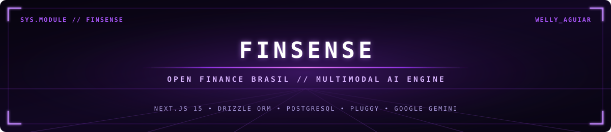
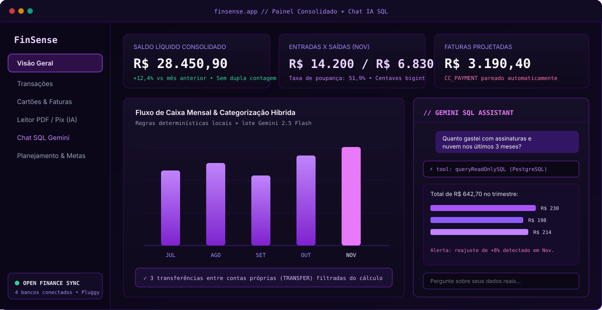

<div align="center">
  
  <br />
  <br />
  
  
  
  
  
  
</div>

<br />

Software web de uso pessoal projetado para rodar **gratuitamente na Vercel**, consolidando contas bancárias, entradas, saídas, cartões de crédito, orçamentos, assinaturas e metas com **Open Finance Brasil (Meu Pluggy)** e **Google Gemini API**.

<br />

<div align="center">
  
</div>

## Principais Recursos

- **Open Finance Brasil Gratuito (Meu Pluggy):** sincronização automática de até 5 instituições no mesmo CPF (contas, saldos, cartões, faturas e transações), sob demanda ou via Cron diário da Vercel.
- **Motor Financeiro Sem Dupla Contagem:** valores sempre em centavos (`bigint`), detecção e pareamento automático de transferências entre contas próprias (`TRANSFER`) e pagamentos de fatura (`CC_PAYMENT`), além de projeção de parcelas futuras de cartão.
- **Categorização Híbrida (Regras + Gemini):** regras locais de custo zero com aprendizado automático das suas correções + lote no Gemini Flash para limpar nomes confusos de fatura.
- **Leitor Multimodal de PDFs & Comprovantes:** envie faturas em PDF, notas fiscais, boletos ou prints de Pix; o Gemini extrai os lançamentos e alerta se já existe registro similar no Open Finance.
- **Chat IA com Dados Reais + Gráficos Inline:** o Gemini consulta consultas SQL read-only exatas no PostgreSQL (via tool calling) e renderiza gráficos interativos dentro da conversa.
- **Alertas Proativos & Relatório Mensal:** detecção de reajustes em assinaturas, anomalias de gasto por categoria, ritmo de orçamento e diagnóstico mensal no painel.
- **Segurança Single-User & Portabilidade:** login Google OAuth (Auth.js v5) travado exclusivamente ao seu `ALLOWED_EMAIL` + exportação completa de backup em JSON e CSV.

---

## Configuração Rápida (Custo Zero)

### 1. Banco PostgreSQL Gratuito (Neon ou Supabase)
1. Crie uma conta gratuita em [neon.tech](https://neon.tech) ou [supabase.com](https://supabase.com).
2. Copie a connection string PostgreSQL para `DATABASE_URL`.

### 2. Google OAuth (Login exclusivo para seu e-mail)
1. No [Google Cloud Console](https://console.cloud.google.com/apis/credentials), crie um **OAuth 2.0 Client ID** (tipo *Web Application*).
2. Adicione como *Authorized redirect URIs*:
   - Local: `http://localhost:3000/api/auth/callback/google`
   - Produção: `https://SEU-APP.vercel.app/api/auth/callback/google`
3. Preencha `AUTH_GOOGLE_ID`, `AUTH_GOOGLE_SECRET`, `ALLOWED_EMAIL` e gere `AUTH_SECRET` (`openssl rand -base64 32`).

### 3. Google Gemini API (Créditos do Google AI Pro)
1. Acesse o [Google AI Studio](https://aistudio.google.com/apikey), vincule seus créditos mensais do Google Developer Program / AI Pro e gere sua chave.
2. Preencha `GOOGLE_GENERATIVE_AI_API_KEY` (padrão `GEMINI_MODEL="gemini-2.5-flash"`).

### 4. Open Finance Brasil — Meu Pluggy (Grátis até 5 bancos)
1. Crie sua conta em [meu.pluggy.ai](https://meu.pluggy.ai) e conecte seus bancos via Open Finance.
2. Acesse [dashboard.pluggy.ai](https://dashboard.pluggy.ai) com o mesmo e-mail, crie uma aplicação para obter `PLUGGY_CLIENT_ID` e `PLUGGY_CLIENT_SECRET`, e copie os **Item IDs** das suas conexões para colar em `/configuracoes`.

---

## Rodando Localmente

```bash
# 1. Copie as variáveis de ambiente e preencha suas chaves
cp .env.example .env.local

# 2. Crie as tabelas no PostgreSQL
npm run db:push

# 3. Popule categorias e regras iniciais brasileiras
npm run db:seed

# (Opcional) Carregue 4 meses de dados fictícios realistas para testar tudo antes de conectar bancos reais
npm run db:seed:demo

# 4. Inicie o servidor de desenvolvimento
npm run dev
```

## Deploy Gratuito na Vercel (Plano Hobby)

1. Suba este repositório em um repositório privado no GitHub.
2. Importe o projeto na [Vercel](https://vercel.com/new) no plano **Hobby (grátis)**.
3. Cadastre todas as variáveis do `.env.example` nas **Environment Variables** da Vercel (incluindo `CRON_SECRET` para o sync diário configurado em `vercel.json`).
4. Clique em **Deploy** e adicione a URL de produção nos *Authorized redirect URIs* do Google OAuth.

## Scripts Úteis

- `npm run test` — executa os testes unitários (`vitest`) das regras financeiras e segurança.
- `npm run typecheck` — valida tipagem TypeScript estrita.
- `npm run lint` — executa ESLint.
- `npm run build` — build de produção Next.js.
